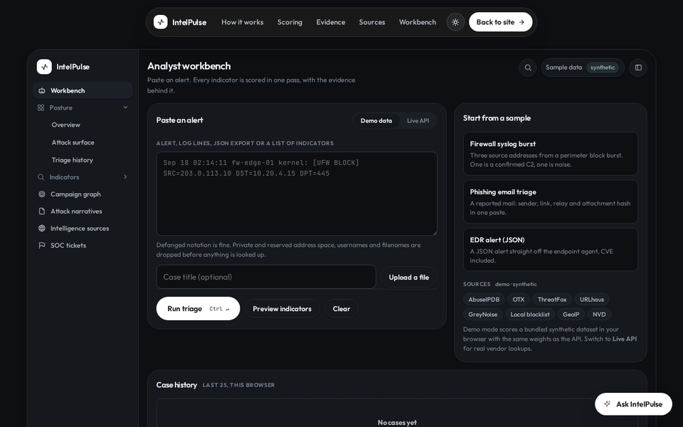
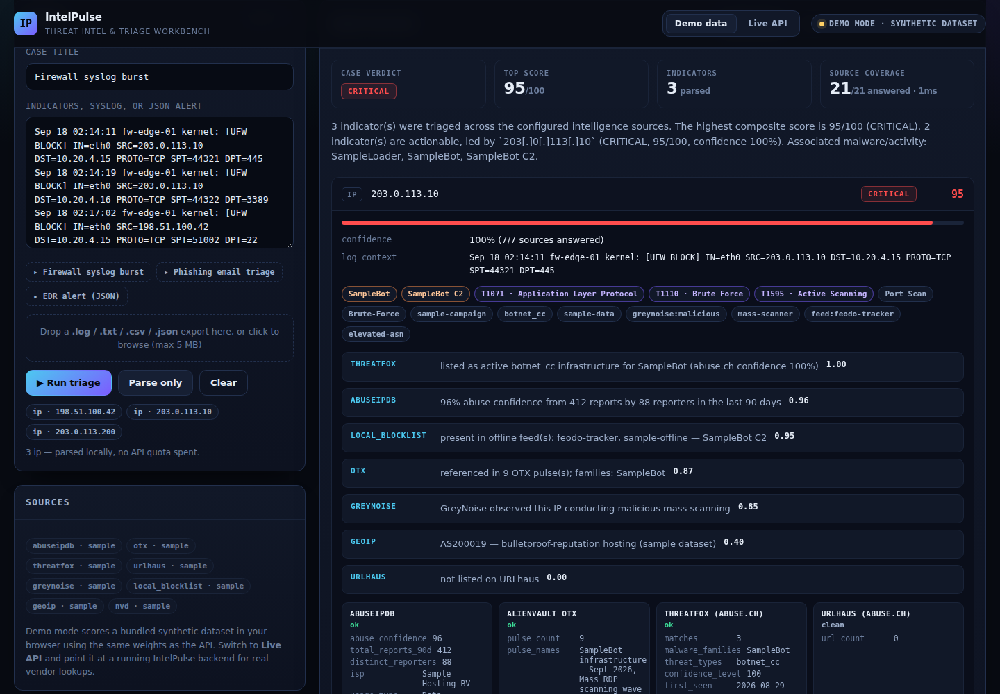
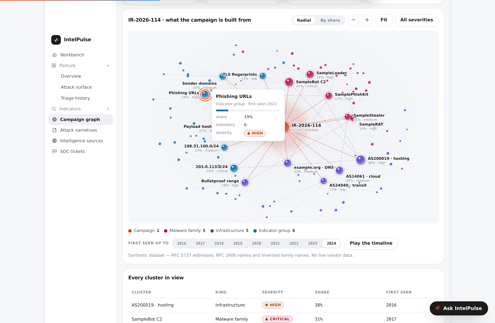
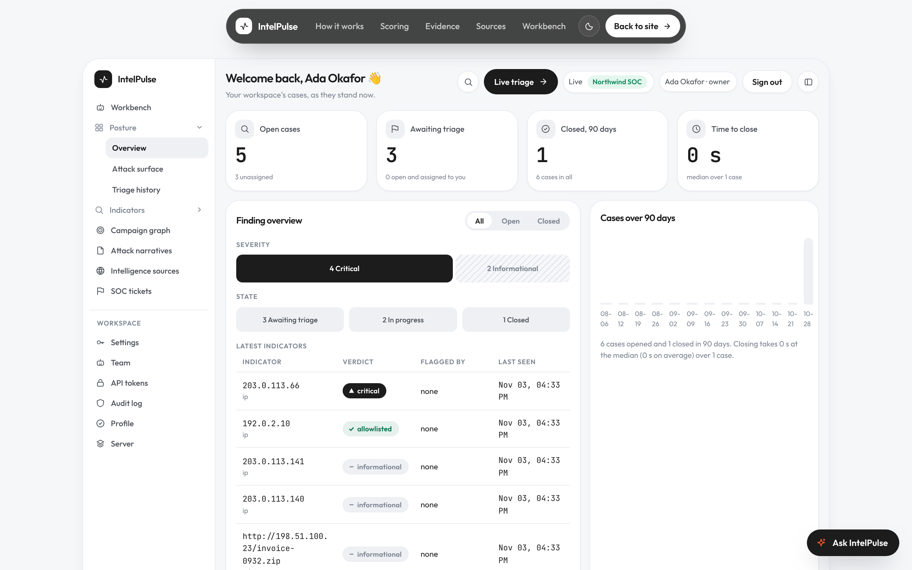
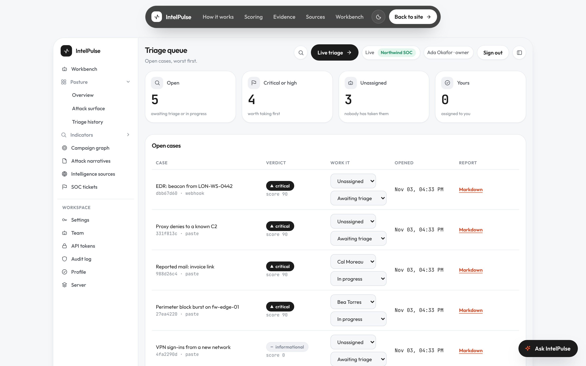
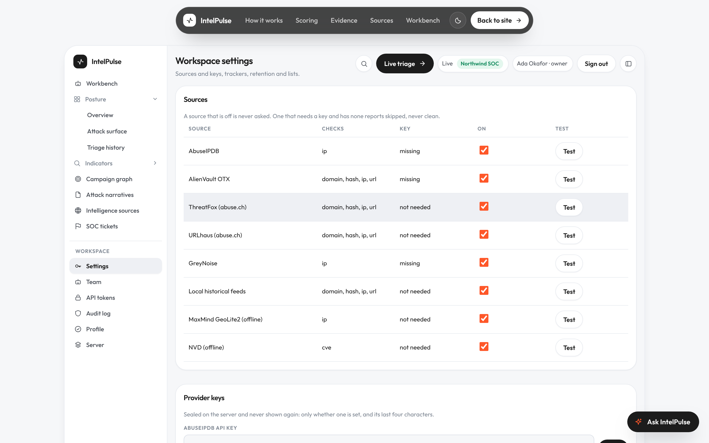
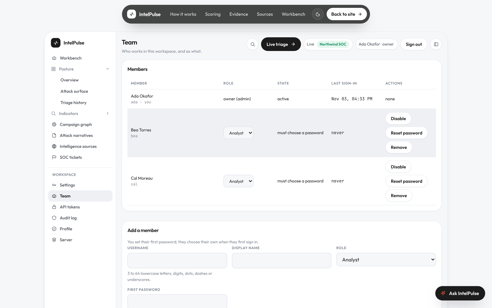
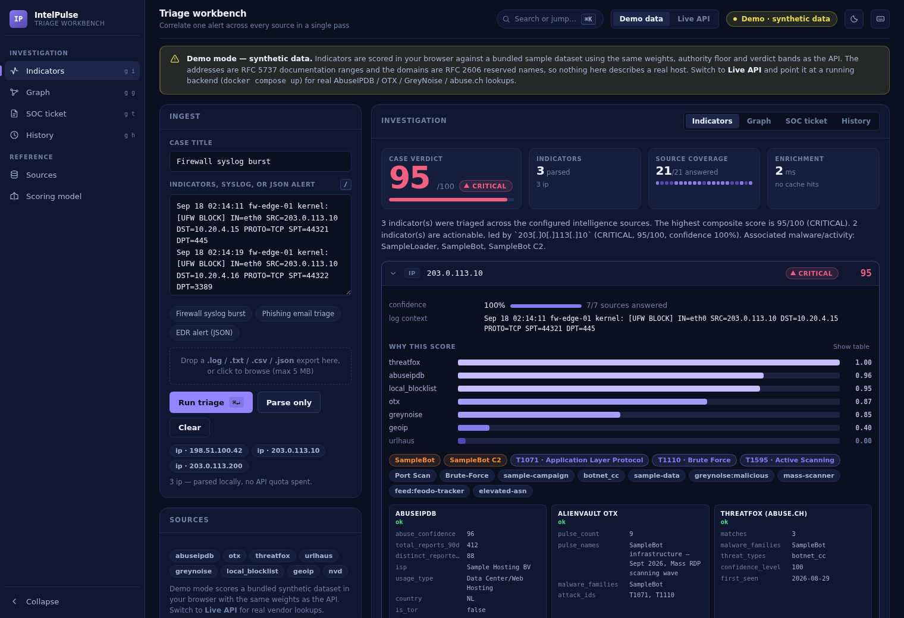
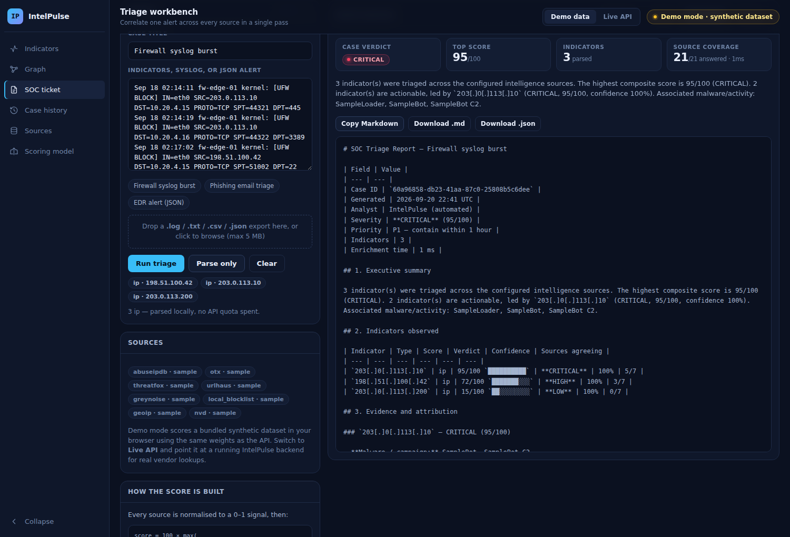

# IntelPulse: Automated Threat Intelligence & Triage Workbench

[](https://github.com/vinitrami-Soc/intelpulse/actions/workflows/intelpulse.yml)
[](CHANGELOG.md)
[](LICENSE)


[](https://vinitrami-soc.github.io/intelpulse/)

## For reviewers

- **Problem:** one SOC alert means checking every indicator in it on five or six vendor sites by hand, and at forty alerts a shift that is where triage time goes and where indicators get missed.
- **What it does:** paste an alert and IntelPulse extracts the indicators, queries AbuseIPDB, OTX, GreyNoise, ThreatFox, URLhaus and offline feeds at once, and returns one auditable score per indicator, a relationship graph and a ticket ready for Jira or ServiceNow.
- **One metric:** 100% precision and 100% recall extracting 9,325 indicators from a 3,400 line, 15 format test corpus that the project generates ([method and caveats](docs/EXTRACTION-BENCHMARK.md)).
- **Demo** ([live, nothing to install](https://vinitrami-soc.github.io/intelpulse/web/#/console/workbench)): 
- **Run it:** `git clone https://github.com/vinitrami-Soc/intelpulse && cd intelpulse && make keys && docker compose up --build`, then open http://localhost:8000 (no API keys needed; sources without one report `skipped`).
- **For a team (2.0):** accounts, workspaces and roles; sign-up, invitations and email reset; alert text sealed and deleted after each workspace's retention period; a hash-chained audit log; and a deploy kit with Postgres behind a Cloudflare Tunnel ([DEPLOY.md](docs/DEPLOY.md), [security review](docs/SECURITY-REVIEW.md)).

---

## What it actually does

| Capability | Detail |
| --- | --- |
| **Multi-format ingestion** | Plain IOC lists, firewall/proxy syslog, Windows EVTX-as-JSON, SIEM alert exports, `.log/.txt/.csv/.json` upload up to 5 MB. Defanged notation (`1.2.3[.]4`, `hxxp://`) is refanged; RFC1918/loopback/CGNAT space and filenames like `svchost.exe` are dropped before anything leaves the building. |
| **Parallel enrichment** | One `httpx.AsyncClient`, one task per (indicator × provider), a global semaphore, per-provider timeouts and `return_exceptions=True`: a dead vendor degrades the result instead of failing the request. |
| **Composite scoring** | A weighted mean of the sources that actually answered, floored by the most authoritative single hit, then modified by GreyNoise noise-filtering and analyst allow/block lists. Confidence is reported separately from score. [Full model →](docs/SCORING.md) |
| **Quota-aware caching** | Every provider response, failures included at a shorter TTL, is cached by `(provider, ioc)` in Redis (24 h default). The same IP triaged three times in a shift costs one quota unit, not three. |
| **Offline datasets** | Feodo Tracker, FireHOL level 1, ThreatFox daily dump, CISA KEV and an NVD CVE slice are imported into Postgres/SQLite; MaxMind GeoLite2 resolves geo/ASN locally. The platform keeps working when the free API quotas run out or the box has no internet. |
| **Investigation graph** | Indicators, malware families, ASNs, countries, campaigns and payload hashes as an SVG graph drawn in the page, so "is this one thing or five things?" is answerable at a glance. |
| **SOC ticket output** | One click produces Markdown or JSON: severity + priority SLA, executive summary, per-indicator evidence with the rationale each source gave, ATT&CK techniques, and a containment checklist written as defender actions. |
| **Case history & audit** | Every triage is persisted with its full provider payload, so a report can be regenerated later and an auditor can see who ran what and when. |
| **Hardened by default** | Outbound host allowlist with resolution checks, per-endpoint rate limits, bounded payloads, security headers, JSON logs with credential masking, and a UI that treats every log line as hostile. [Full posture →](docs/SECURITY.md) |

<p align="center">
  
  
</p>

On a server, every view reads the workspace's own cases, and the workspace's panes sit beside them
(sample data, RFC 5737 addresses):

<p align="center">
  
  
</p>
<p align="center">
  
  
</p>

---

## Architecture

```
                 ┌──────────────────────────────────────────────┐
  paste / upload │  Dashboard (static HTML/CSS/JS, no framework) │
  ──────────────▶│  demo mode: scores a bundled dataset in-page │
                 └───────────────┬──────────────────────────────┘
                                 │ REST (JSON)
                 ┌───────────────▼──────────────────────────────┐
                 │  FastAPI  ── /api/extract  /api/triage        │
                 │           ── /api/triage/report  /api/cases   │
                 │  ┌────────────────────────────────────────┐  │
                 │  │ ioc.py      regex + refang + RFC filter │  │
                 │  │ enrichment/ one class per source        │  │
                 │  │ scoring.py  weights, authority, modifiers│ │
                 │  │ graph.py    relationship builder        │  │
                 │  │ reporting.py Markdown / JSON ticket     │  │
                 │  └────────────────────────────────────────┘  │
                 └───┬──────────────┬─────────────┬─────────────┘
                     │              │             │
              ┌──────▼─────┐ ┌──────▼──────┐ ┌────▼─────────────┐
              │ Redis      │ │ PostgreSQL  │ │ Celery + beat    │
              │ quota cache│ │ cases,lists │ │ feed refreshes   │
              └────────────┘ │ feeds, CVEs │ └──────────────────┘
                             └─────────────┘
   live APIs: AbuseIPDB · AlienVault OTX · GreyNoise · ThreatFox · URLhaus
   offline:   MaxMind GeoLite2 · Feodo Tracker · FireHOL · CISA KEV · NVD
```

**Stack:** Python 3.12 · FastAPI · httpx (async) · SQLAlchemy 2.0 (async) · PostgreSQL/SQLite ·
Redis · Celery + beat · vanilla JS dashboard · Docker Compose.

The dashboard is static HTML, CSS and JavaScript with no framework and no build step, so it serves the
same from GitHub Pages, nginx or `python -m http.server`, and the IntelPulse server serves it itself,
on the API's own origin. Its fonts are bundled (SIL OFL), so no page asks a third party for anything. How it is designed, and why, is in
[docs/DESIGN.md](docs/DESIGN.md).

---

## Quickstart

### Docker (everything, one command)

```bash
git clone https://github.com/vinitrami-Soc/intelpulse && cd intelpulse
cp .env.example .env        # optional: paste any free API keys you have
make keys                   # once: the key that seals alert text and secrets
docker compose up --build
# Console   → http://localhost:8000        (the pages and the API on one origin)
# API docs  → http://localhost:8000/docs
```

Provider keys belong to a workspace: an admin sets them in its settings (`PATCH /api/settings`),
sealed, and each workspace's lookups spend only its own keys and keep their own cache. Keys left in
`.env` from 1.x move into the first organization once, on the first start of v2.

No API keys? It still runs. Unconfigured providers report themselves as `skipped` in `/api/health`
and in every result: the platform never presents a missing source as a clean verdict.

### A server for a team

`deploy/` is the kit for running it for real: Postgres, Redis, the worker and beat, and a Cloudflare
Tunnel so the machine needs no open port. `./deploy/setup.sh` writes the secrets, starts everything
and prints the owner's one-time setup code; `deploy/backup.sh`, `restore.sh` and `update.sh` do the
rest, and `deploy/smoke.py` checks a server end to end. Step by step in [DEPLOY.md](docs/DEPLOY.md);
running it afterwards in [SERVER.md](docs/SERVER.md).

The API needs a caller. On a new server, `docker compose exec api python -m app.cli setup-code`
prints a one-time code that creates the owner's account with `POST /api/setup`; the owner then
makes API tokens for scripts (`read`, `triage` or `ingest`). The 1.x `API_TOKEN` still works for
the endpoints 1.x had, and is deprecated. Details: [docs/API.md](docs/API.md#signing-in-and-api-tokens).

### Local, without Docker

```bash
make install                 # venv + dependencies
make keys                    # once: ENCRYPTION_KEY in .env
make test                    # 647 tests, no network required
make dev                     # http://localhost:8000/docs

make seed                    # optional: bundled sample feed rows for an offline demo
make feeds                   # optional: import the real offline datasets (needs internet)
# make dev also serves the console at http://localhost:8000; the static demo alone:
python -m http.server 8080 --directory web
```

### Terminal triage

```bash
cd backend
python -m app.cli triage 185.220.101.34 --report     # prints a Markdown SOC ticket
python -m app.cli feeds --all                        # refresh every offline dataset
```

---

## API

| Method | Path | Purpose |
| --- | --- | --- |
| `POST` | `/api/extract` | Parse-only: see what would be triaged without spending a single API call |
| `POST` | `/api/triage` | Enrich every indicator in parallel, score, correlate, persist |
| `POST` | `/api/triage/upload` | Same, from a `.log/.txt/.csv/.json` file |
| `POST` | `/api/triage/report?fmt=markdown\|json` | Triage and return a ready-to-paste SOC ticket |
| `GET` | `/api/cases`, `/api/cases/{id}`, `/api/cases/{id}/report` | Case history and report regeneration |
| `GET`/`POST`/`DELETE` | `/api/lists` | Analyst allowlist / blocklist |
| `GET` | `/api/intel/feeds`, `POST /api/intel/feeds/{feed}/refresh` | Offline dataset status and refresh |
| `GET` | `/api/health`, `/api/scoring/model` | Which sources are live, and the exact weights behind a verdict |

Full reference with request/response examples: [docs/API.md](docs/API.md).

```bash
curl -s -X POST localhost:8000/api/triage \
  -H 'Content-Type: application/json' \
  -d '{"text":"SRC=185.220.101.34 blocked; hxxp://bad-domain[.]top/x.exe"}' | jq '.verdict, .score'
```

---

## The scoring model in one paragraph

Each source is normalised to a signal between 0 and 1. The engine then takes the **higher** of a
weighted mean (over the providers that actually answered, so a dead API cannot deflate a verdict) and
an **authority floor** (`max(signal × authority)`, so one confirmed abuse.ch C2 listing still reads
*critical* when five quieter sources shrug). Modifiers encode analyst judgement: a GreyNoise `benign`
result (Shodan, Censys, academic scanners) damps the score ×0.45; an allowlist entry forces 0; a
blocklist entry forces ≥ 90. **Confidence** is computed and displayed separately, because "85/100
from one source" and "85/100 from five" are different instructions to an analyst. Weights are
configuration, not code, and `GET /api/scoring/model` returns them so any verdict can be audited.

Worked examples and the full rationale: [docs/SCORING.md](docs/SCORING.md).
Security controls and their tests: [docs/SECURITY.md](docs/SECURITY.md).

---

## Investigation graph and ticket output





The Markdown ticket is written to be pasted straight into Jira or ServiceNow: severity with a priority
SLA, an executive summary, the evidence each source gave in its own words, ATT&CK techniques, and a
containment checklist (`- [ ] Block the address at the perimeter firewall…`) scoped to the indicator
type and verdict. Indicators are defanged in the report so a ticket comment can never be click-through.

---

## Using it

Open **Workbench** in the console sidebar, paste an alert (or pick one of the sample alerts) and run
it: <kbd>Ctrl</kbd>+<kbd>↵</kbd> or <kbd>⌘</kbd>+<kbd>↵</kbd> from the box does the same. In the
graphs, <kbd>Tab</kbd> reaches every node and <kbd>Enter</kbd> opens it; <kbd>Escape</kbd> closes the
scoring dialog and the graph readout.

Every indicator opens to show **why** it scored what it did: a contribution bar per source (with a
table view), the rationale each vendor gave in its own words, the modifiers that were applied, and a
**Scoring math** button that prints the actual arithmetic (weighted mean, authority floor, final
verdict). Nothing about a score is hidden behind the number.

### Demo mode vs live mode

The GitHub Pages deployment runs **demo mode**: `web/assets/engine.js` is a faithful port of the
backend's extraction, scoring and reporting modules, so the browser scores a bundled dataset with the
same weights, authority floor and verdict bands as the API. That dataset is **synthetic** (RFC 5737
documentation addresses and RFC 2606 reserved domains) and the UI says so on every screen and in every
generated report. Nothing in demo mode describes a real host, and no vendor API is called.

Run IntelPulse yourself and open it in a browser, and the same pages become **server mode**
(`web/assets/data.js` asks the server whether it is one). A new server asks for its one-time setup
code at `#/setup`; after that the console needs a sign-in, and the workbench triages on the server
with real AbuseIPDB / OTX / GreyNoise / abuse.ch responses, storing each case in your workspace. Every
other view then reads that workspace's own cases instead of the sample: the overview's bands, trend
and time to close, the attack surface your pushed alerts name, the triage history (searchable) and
the queue (assign and close from it), every indicator, the campaigns, the attack narratives, the
sources and the tickets. A Workspace group in the sidebar holds the rest: for an admin, Settings
(sources and their keys, Jira and ServiceNow, retention, allow and block lists), Team (with
invitation links) and API tokens;
for everyone, the Audit log (with Verify the chain for admins) and their Profile. No API address or
token is typed into the page: the session cookie and its CSRF token do the work.

---

## Testing

```bash
make test        # 647 backend tests: extraction (incl. the 3,400-line corpus), scoring,
                 # API contract, reports, security controls, the 2026 audit's regressions
make test-web    # 61 node tests: engine parity, console model, design and asset guards
make test-ui     # Chromium: the workbench and graph, the site and console, phones and
                 # tablets, and a hostile-input security suite
make test-server # Chromium against a new server: setup, sign-in, triage, every view and pane, sign-out
make lint        # ruff
make audit       # pip-audit against the pinned requirements
```

All of it runs on every push to `main` and every pull request (`.github/workflows/intelpulse.yml`),
with the same commands, so a green run there means what a green run in a terminal means. The browser
suites are a matrix, so a failure names which surface broke rather than "browser tests".

`pip-audit` is deliberately **not** in that workflow. A new advisory against a pinned dependency is
worth knowing about, but it has nothing to do with whoever opened the pull request that happened to
run next, and blocking their change on it is how people learn to ignore red. It runs weekly on its own
schedule instead (`.github/workflows/audit.yml`).

Provider classes are stubbed in the API tests, so assertions describe pipeline behaviour rather than
whatever AbuseIPDB happens to say today. The backend suite needs no network, no API keys and no Redis.
The browser-engine suite pins the JavaScript implementation to the same extraction rules, weights,
authority floor and verdict bands as the Python one, so demo mode cannot quietly drift away from the
real pipeline. The UI suites drive a real Chromium: they paste `<script>`, `` and
`javascript:` payloads into the ingest field and assert nothing executes, feed the renderer a hostile
provider response and assert the link is dropped, and kill the backend mid-request to check the page
degrades instead of freezing. What the interface suites check beyond that is in
[docs/DESIGN.md](docs/DESIGN.md#how-the-interface-is-tested).

---

## Security and honesty notes

Full detail, with the test that proves each control, is in [docs/SECURITY.md](docs/SECURITY.md).
The September 2026 OWASP audit (thirteen findings, each reproduced, fixed and pinned by a test) is in
[docs/SECURITY-AUDIT.md](docs/SECURITY-AUDIT.md). The short version:

* **Every caller is someone.** Every data route needs a signed-in session (with its CSRF token on
  writes) or a scoped API token; each workspace sees only its own cases, lists and tokens, and
  another workspace's id is a plain `404`. A `POST` or `DELETE` a browser sends from any origin not
  in `CORS_ORIGINS` is refused, because CORS alone never stopped a form post. The audit log is a
  hash chain that records who the server verified, not the name a client typed.
* **Egress is allowlisted.** Twelve known intelligence hosts, HTTPS only, resolution checked against
  private/loopback/link-local/metadata space on every hop including redirects. IntelPulse never
  fetches an analyst-supplied URL, and the allowlist means it never could.
* **Internal addresses never leave.** Private, loopback, link-local, CGNAT and documentation space is
  filtered during extraction, before any provider is called.
* **Quota and CPU are budgeted.** Per-client rate limits sized per endpoint (triage 30/min, writes
  60/min, reads 240/min), 1 MiB JSON bodies (counted as they stream, chunked or not), 5 MiB text-only
  uploads, 200 000 characters of text, 100 indicators per request, and extraction patterns that stay
  linear on hostile input. `X-Forwarded-For` is ignored unless explicitly trusted.
* **Logs are JSON and masked.** Request id, client, route, status and duration, with configured
  secrets and anything credential-shaped redacted from messages, arguments and tracebacks.
* **The UI treats every log line as hostile.** Output encoding everywhere, `http(s)`-only URL
  validation on links that come from providers, one normalising boundary for every result the API
  returns, validated browser storage, and a CSP that blocks inline script and `eval`. Tickets are
  escaped and defanged, so a title or a vendor string cannot write a section.
* **Dependencies are audited.** `make audit`; the pins moved forward when `pip-audit` found advisories
  in the originals.
* **Nothing is overstated.** Unconfigured or failing sources are reported as `skipped`/`error`,
  never as "clean", and every report states its source coverage. What 2.0 leaves open (an
  in-process rate limiter, an audit chain without a secret, and the rest) is listed in the
  [review's residual risk](docs/SECURITY-REVIEW.md#residual-risk).
* Secrets live in `.env` only; the API container runs as an unprivileged user with a healthcheck.
* Containment guidance is defensive only: block, hunt, isolate, revoke, patch.

---

## Contributing

Wrong verdicts, missed indicators, new sources and fixes are welcome: see
[CONTRIBUTING.md](CONTRIBUTING.md). Please report vulnerabilities privately, as
[SECURITY.md](SECURITY.md) describes, not as a public issue. Changes are recorded in
[CHANGELOG.md](CHANGELOG.md).

---

## Roadmap

- [x] Webhook ingestion so a SIEM can push alerts directly (`POST /api/alerts`, see [docs/API.md](docs/API.md))
- [x] Accounts, workspaces and roles, sealed alert text with retention, an audit chain, and a deploy kit (2.0)
- [ ] New providers: MalwareBazaar, VirusTotal, Shodan InternetDB, EPSS, RDAP, urlscan.io
- [ ] Notifications: Slack, Teams, PagerDuty, signed webhooks
- [ ] STIX 2.1 and MISP export alongside Markdown and JSON
- [ ] SIEM adapters, an External Dynamic List for firewalls, and the PhishHawk handoff
- [ ] Single sign-on (OIDC)
- [ ] Prometheus metrics, and a shared rate limiter for multi-replica deployments

---

Built by [Vinit Rami](https://vinitrami-soc.github.io/): offensive-security background, defensive
engineering focus.

## Licence

MIT, see [LICENSE](LICENSE).
