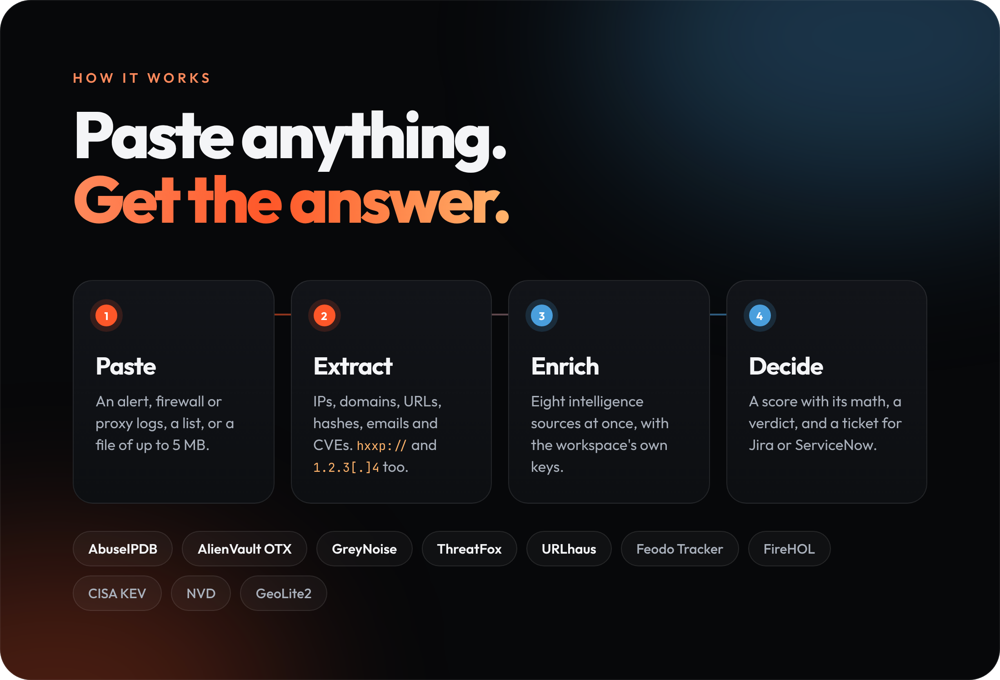
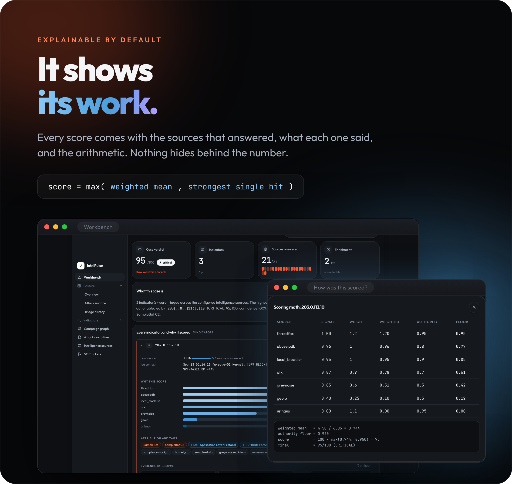
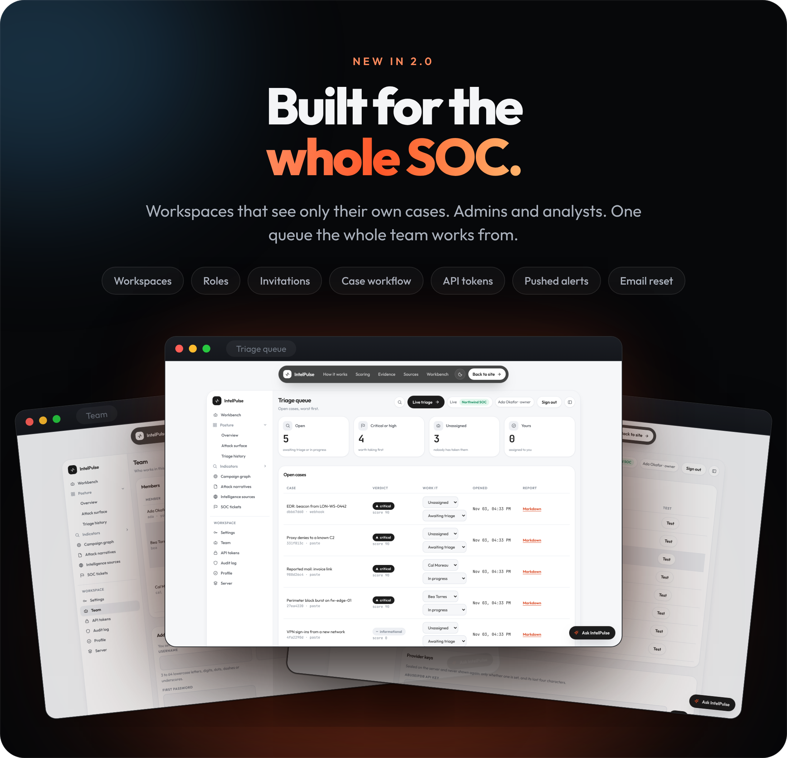
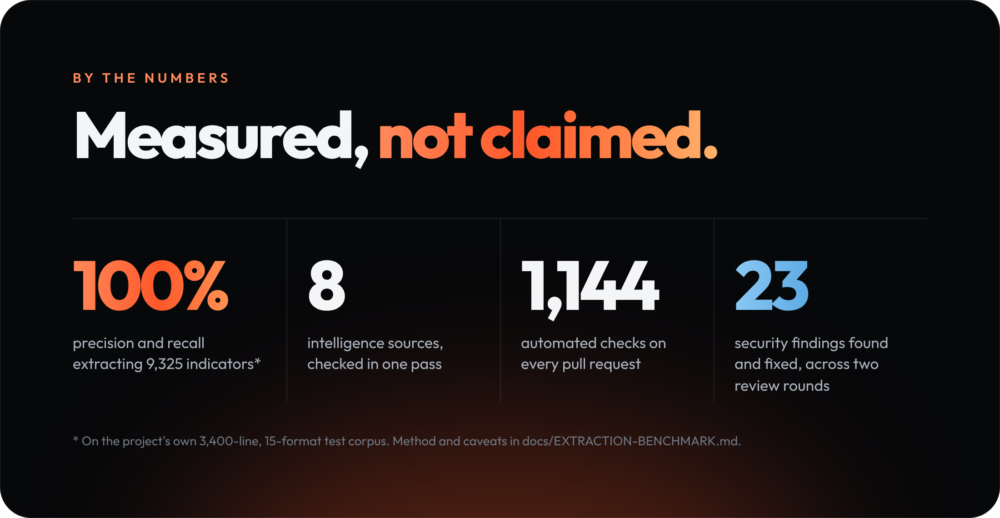

<p align="center">
  <a href="https://vinitrami-soc.github.io/intelpulse/web/#/console/workbench">
    
  </a>
</p>

<p align="center">
  <b>Paste a security alert. IntelPulse checks every indicator in it against every intelligence source at once,<br>
  scores each one with its arithmetic in plain sight, and writes the ticket.</b><br>
  Open source, self-hosted, and now built for a whole SOC.
</p>

<p align="center">
  <a href="https://github.com/vinitrami-Soc/intelpulse/actions/workflows/intelpulse.yml"></a>
  <a href="CHANGELOG.md"></a>
  <a href="LICENSE"></a>
  
  
  
  <a href="docs/DEPLOY.md"></a>
</p>

<p align="center">
  <a href="https://vinitrami-soc.github.io/intelpulse/web/#/console/workbench"><b>Try the live demo</b></a> ·
  <a href="#get-started">Get started</a> ·
  <a href="docs/DEPLOY.md">Deploy your own</a> ·
  <a href="docs/API.md">API</a> ·
  <a href="docs/SCORING.md">Scoring model</a> ·
  <a href="docs/SECURITY-REVIEW.md">Security review</a> ·
  <a href="CHANGELOG.md">What's new in 2.0</a>
</p>

<br>

<h2 align="center">Twenty minutes, every alert.</h2>

<p align="center">
  One alert names five indicators. Checking each of them on five or six vendor sites by hand can take<br>
  twenty minutes, and at forty alerts a shift, that is where triage time goes and where indicators get missed.<br>
  <b>IntelPulse does that pass in one request, and shows its working.</b>
</p>

<p align="center">
  
</p>

<br>

<p align="center">
  
</p>

<p align="center">
  A weighted mean of the sources that answered, never lowered by one that did not, and raised to the<br>
  strongest single authoritative hit, so one confirmed C2 listing still reads <i>critical</i>. The weights are<br>
  configuration, and <code>GET /api/scoring/model</code> publishes them. <a href="docs/SCORING.md">The full model</a>.
</p>

<br>

<p align="center">
  
</p>

<div align="center">

| | |
| :--- | :--- |
| **Workspaces** | Sign up for yourself or your organization. A workspace sees only its own cases, indicators, settings and audit records; another workspace's ID is a plain `404`. |
| **A team** | Admins invite members, set roles, keep the providers' keys and the trackers' credentials, and make API tokens that can only read, triage or push alerts. |
| **A case workflow** | A status, an assignee and a closing reason on every case; a queue ordered by priority; a history that searches all of them. |
| **Pushed alerts** | A SIEM or an EDR posts to `/api/alerts` with an ingest token and gets a triaged case back. |

</div>

<br>

<p align="center">
  
</p>

<p align="center">
  What leaves the server is the indicator itself, sent only to the sources a workspace turned on.<br>
  The <a href="https://vinitrami-soc.github.io/intelpulse/web/privacy.html">privacy page</a> says what a server keeps and for how long, and
  <a href="docs/SECURITY.md">SECURITY.md</a> names the test behind every control.
</p>

<br>

<p align="center">
  
</p>

<p align="center">
  <sub>The corpus is generated by the project, which is its main caveat: <a href="docs/EXTRACTION-BENCHMARK.md">method and caveats</a>.
  The checks are 647 backend tests, 61 Node tests and 436 Chromium checks across five suites. The findings are in the
  <a href="docs/SECURITY-AUDIT.md">September audit</a> (13) and the <a href="docs/SECURITY-REVIEW.md">November review</a> (10).</sub>
</p>

<br>

<p align="center">
  
</p>

<br>

## Get started

| | Try it | Run it on your machine | Run it for a team |
| --- | --- | --- | --- |
| **What** | The demo, in your browser, on synthetic data | Everything, with Docker | Postgres, Redis and a Cloudflare Tunnel, no open port |
| **How** | [Open the workbench](https://vinitrami-soc.github.io/intelpulse/web/#/console/workbench) and pick a sample alert | `make keys && docker compose up --build` | `./deploy/setup.sh` ([DEPLOY.md](docs/DEPLOY.md)) |
| **Needs** | Nothing | Docker | A Linux machine with Docker (Oracle Cloud's Always Free Ampere machine is enough), and a domain on Cloudflare |

### On your machine

```bash
git clone https://github.com/vinitrami-Soc/intelpulse && cd intelpulse
make keys                   # once: the key that seals alert text and secrets
docker compose up --build
# Console  → http://localhost:8000   (the pages and the API on one origin)
# API docs → http://localhost:8000/docs
```

Then `docker compose exec api python -m app.cli setup-code` prints the one-time code that makes the
owner's account at `http://localhost:8000/#/setup`. No API keys? It still runs: a source without one
reports `skipped`, never "clean", and an admin adds keys later in Settings.

### For a team

```bash
git clone https://github.com/vinitrami-Soc/intelpulse && cd intelpulse
./deploy/setup.sh           # asks for the address and the tunnel token, starts everything
```

`setup.sh` writes the secrets, builds, starts Postgres, Redis, the app, its worker and beat, and the
tunnel, and prints the owner's setup code. `backup.sh`, `restore.sh` and `update.sh` do the rest, and
`deploy/smoke.py` signs an account up, triages a sample and checks the verdict against any address.
Step by step in [DEPLOY.md](docs/DEPLOY.md), from an Oracle Cloud machine and a Cloudflare Tunnel to
deploys from GitHub on every release; running it afterwards in [SERVER.md](docs/SERVER.md).

### Without Docker

```bash
make install                 # venv + dependencies
make keys                    # once: ENCRYPTION_KEY in .env
make test                    # 647 tests, no network required
make dev                     # http://localhost:8000, the console and /docs
make feeds                   # optional: import the real offline datasets (needs internet)
```

From a terminal: `python -m app.cli triage 185.220.101.34 --report` (in `backend/`) prints a Markdown
SOC ticket.

<br>

## Under the hood

<details>
<summary><b>What it does, capability by capability</b></summary>
<br>

| Capability | Detail |
| --- | --- |
| **Multi-format ingestion** | Plain IOC lists, firewall/proxy syslog, Windows EVTX-as-JSON, SIEM alert exports, `.log/.txt/.csv/.json` upload up to 5 MB. Defanged notation (`1.2.3[.]4`, `hxxp://`) is refanged; RFC1918/loopback/CGNAT space and filenames like `svchost.exe` are dropped before anything leaves the building. |
| **Parallel enrichment** | One `httpx.AsyncClient`, one task per (indicator × provider), a global semaphore, per-provider timeouts and `return_exceptions=True`: a dead vendor degrades the result instead of failing the request. |
| **Composite scoring** | A weighted mean of the sources that actually answered, floored by the most authoritative single hit, then modified by GreyNoise noise-filtering and analyst allow/block lists. Confidence is reported separately from score. [Full model](docs/SCORING.md) |
| **Quota-aware caching** | Every provider response, failures included at a shorter TTL, is cached in Redis (24 h default), per workspace for answers fetched with its key. The same IP triaged three times in a shift costs one quota unit, not three. |
| **Offline datasets** | Feodo Tracker, FireHOL level 1, ThreatFox daily dump, CISA KEV and an NVD CVE slice are imported into Postgres/SQLite; MaxMind GeoLite2 resolves geo/ASN locally. The platform keeps working when the free API quotas run out or the box has no internet. |
| **Investigation graph** | Indicators, malware families, ASNs, countries, campaigns and payload hashes as an SVG graph drawn in the page, so "is this one thing or five things?" is answerable at a glance. |
| **SOC ticket output** | Markdown or JSON: severity and priority SLA, executive summary, per-indicator evidence with the rationale each source gave, ATT&CK techniques, and a containment checklist written as defender actions. Indicators are defanged, so a ticket comment can never be click-through. Filed straight into Jira or ServiceNow when a workspace has them. |
| **Cases and audit** | Every triage is a case with its full provider payload, so a report can be regenerated later; every change is in a hash-chained audit log. |

<p align="center">
  
  
</p>

</details>

<details>
<summary><b>Architecture</b></summary>
<br>

```
                 ┌──────────────────────────────────────────────┐
  paste / upload │  Console (static HTML/CSS/JS, no framework)  │
  ──────────────▶│  demo: scores a bundled dataset in-page      │
                 │  server: signs in, works on its workspace    │
                 └───────────────┬──────────────────────────────┘
                                 │ same origin: session cookie + CSRF
                 ┌───────────────▼──────────────────────────────┐
                 │  FastAPI  /api/triage  /api/alerts  /api/cases│
                 │           /api/settings /api/users  /healthz  │
                 │  ioc.py · enrichment/ · scoring.py · graph.py │
                 │  platform/: accounts, sessions, tokens, Box   │
                 │  (AES-256-GCM), audit chain, budgets          │
                 └───┬──────────────┬─────────────┬─────────────┘
              ┌──────▼─────┐ ┌──────▼──────┐ ┌────▼─────────────┐
              │ Redis      │ │ PostgreSQL  │ │ Celery + beat    │
              │ quota cache│ │ workspaces, │ │ feeds, retention │
              └────────────┘ │ cases, feeds│ │ sweep, heartbeat │
                             └─────────────┘ └──────────────────┘
   live APIs: AbuseIPDB · AlienVault OTX · GreyNoise · ThreatFox · URLhaus
   offline:   MaxMind GeoLite2 · Feodo Tracker · FireHOL · CISA KEV · NVD
```

**Stack:** Python 3.12 · FastAPI · httpx (async) · SQLAlchemy 2.0 (async) and Alembic ·
PostgreSQL/SQLite · Redis · Celery + beat · argon2id · AES-256-GCM · a vanilla JS console with no
build step · Docker Compose · Cloudflare Tunnel.

The console is static files, so it serves the same from GitHub Pages and from the server itself, on
the API's own origin. Its fonts are bundled (SIL OFL), so no page asks a third party for anything.
How it is designed, and why: [docs/DESIGN.md](docs/DESIGN.md). The design of 2.0:
[the v2 spec](docs/superpowers/specs/2026-11-02-intelpulse-v2-web-design.md).

</details>

<details>
<summary><b>The API</b></summary>
<br>

| Method | Path | Purpose |
| --- | --- | --- |
| `POST` | `/api/extract` | Parse only: what would be triaged, without spending an API call |
| `POST` | `/api/triage`, `/api/triage/upload` | Enrich every indicator in parallel, score, correlate, persist |
| `POST` | `/api/triage/report?fmt=markdown\|json` | Triage and return a ready-to-paste SOC ticket |
| `POST` | `/api/alerts` | A SIEM or EDR pushes an alert; a triaged case comes back |
| `GET`/`PATCH` | `/api/cases`, `/api/cases/{id}` | Cases, search and filters; status, assignee, closing reason |
| `GET`/`PATCH` | `/api/settings`, `/api/users`, `/api/tokens` | The workspace: providers and keys, team, API tokens |
| `GET` | `/healthz`, `/api/health`, `/api/scoring/model` | For monitors; which sources are live; the exact weights |

Scripts use API tokens (`read`, `triage` or `ingest`) made by an admin; the console uses its session.
Full reference with examples: [docs/API.md](docs/API.md).

```bash
curl -s -X POST https://intel.example.org/api/triage \
  -H "Authorization: Bearer $INTELPULSE_TOKEN" -H 'Content-Type: application/json' \
  -d '{"text":"SRC=185.220.101.34 blocked; hxxp://bad-domain[.]top/x.exe"}' | jq '.verdict, .score'
```

</details>

<details>
<summary><b>Using the console</b></summary>
<br>

Open **Workbench**, paste an alert (or pick a sample) and run it: <kbd>Ctrl</kbd>+<kbd>↵</kbd> or
<kbd>⌘</kbd>+<kbd>↵</kbd> from the box does the same. Every indicator opens to show why it scored what
it did: a bar per source (with a table view), the rationale each vendor gave in its own words, the
modifiers applied, and **How was this scored?**, which prints the arithmetic. In the graphs,
<kbd>Tab</kbd> reaches every node and <kbd>Enter</kbd> opens it.

**Demo or server.** On GitHub Pages the console runs in **demo mode**: `web/assets/engine.js` is a
faithful port of the backend's extraction, scoring and reporting, run on a bundled **synthetic**
dataset (RFC 5737 addresses, RFC 2606 names), and every screen says so. Served by an IntelPulse server,
the same pages are in **server mode**: a sign-in, the workspace's own cases in every view (the
overview, the attack surface its pushed alerts name, the history and the queue, every indicator, the
campaigns, the narratives, the sources and the tickets), and the Workspace panes: Settings, Team, API
tokens, Audit, Profile, and for the owner, Server. Help for people using it: [the help page](https://vinitrami-soc.github.io/intelpulse/web/help.html).

</details>

<br>

## Tested, on every change

```bash
make test        # 647 backend tests: extraction (incl. the 3,400-line corpus), scoring, the API
                 # contract, accounts and workspaces, sealing, retention, the security reviews' regressions
make test-web    # 61 node tests: engine parity, console model, design and asset guards
make test-ui     # Chromium: the workbench and graph, the site and console, phones and tablets, hostile input
make test-server # Chromium against a new server: setup, sign-in, triage, every view and pane, sign-out
make lint        # ruff
make audit       # pip-audit against the pinned requirements
```

All of it runs on every pull request, with the same commands, and so does the deploy kit: CI builds
the image, runs `setup.sh` on Postgres, runs the smoke test, and backs up and restores. CodeQL scans
Python, JavaScript and the workflows. `pip-audit` runs weekly on its own schedule, so a new advisory
against a pin never turns an unrelated pull request red. The provider classes are stubbed in the API
tests, so the backend suite needs no network, no API keys and no Redis, and the browser-engine suite
pins the demo's JavaScript to the same rules, weights and bands as the Python, so the two cannot drift.

## Security, and honesty

Every data route needs a signed-in session (with its CSRF token on writes) or a scoped API token, and
each workspace sees only its own data. Outbound requests go only to twelve known intelligence hosts,
over HTTPS, with every hop's address checked. Private and documentation address space never leaves
the server. Alert text is sealed, the audit log is a hash chain, and the console treats every log
line as hostile. Two rounds of review found 23 issues, each fixed and recorded:
[the September audit](docs/SECURITY-AUDIT.md) and [the November review](docs/SECURITY-REVIEW.md),
with [what 2.0 leaves open](docs/SECURITY-REVIEW.md#residual-risk). Every control and the test behind
it: [docs/SECURITY.md](docs/SECURITY.md).

Nothing is overstated: an unconfigured or failing source reports `skipped` or `error`, never "clean",
every report states its source coverage, and the containment it suggests is defensive only (block,
hunt, isolate, revoke, patch). Please report a vulnerability privately, as [SECURITY.md](SECURITY.md)
describes.

## What's next

- [x] Webhook ingestion so a SIEM can push alerts directly (`POST /api/alerts`)
- [x] Accounts, workspaces and roles, sealed alert text with retention, an audit chain, and a deploy kit (2.0)
- [ ] New providers: MalwareBazaar, VirusTotal, Shodan InternetDB, EPSS, RDAP, urlscan.io
- [ ] Notifications: Slack, Teams, PagerDuty, signed webhooks
- [ ] STIX 2.1 and MISP export alongside Markdown and JSON
- [ ] SIEM adapters, an External Dynamic List for firewalls, and the handoff from [PhishHawk](https://github.com/vinitrami-Soc/phishhawk)
- [ ] Single sign-on (OIDC)
- [ ] Prometheus metrics, and a shared rate limiter for multi-replica deployments

## Contributing

Wrong verdicts, missed indicators, new sources and fixes are welcome: see
[CONTRIBUTING.md](CONTRIBUTING.md). Changes are recorded in [CHANGELOG.md](CHANGELOG.md).

<br>

<p align="center">
  Built by <a href="https://vinitrami-soc.github.io/">Vinit Rami</a>: offensive-security background, defensive engineering focus.<br>
  Also by the same hands: <a href="https://github.com/vinitrami-Soc/phishhawk">PhishHawk</a>, phishing email triage for SOC teams.<br>
  <sub>MIT licence, see <a href="LICENSE">LICENSE</a>. Every screenshot is of synthetic data: RFC 5737 addresses, RFC 2606 names, made-up people.</sub>
</p>
